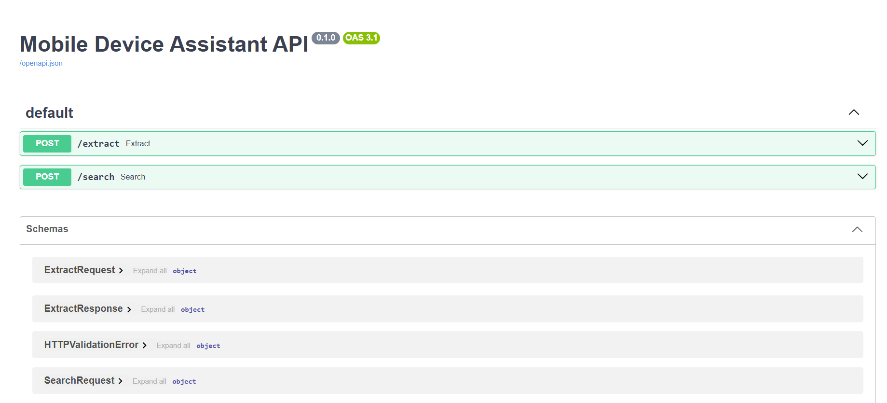

# Mobile Device Assistant API

A FastAPI project with two features:

- Extract structured mobile device specifications from messy text with an LLM and Pydantic validation.
- Search a small device catalog using BM25, dense embeddings, and Reciprocal Rank Fusion (RRF).

## Setup

Use Python 3.10 or newer. From the project directory, create a virtual environment:

```bash
python -m venv .venv
```

Activate the environment using your shell's usual command, then install the requirements:

```bash
python -m pip install -r requirements.txt
```

Copy `.env.example` to `.env` and replace the placeholder with a Groq API key. The environment variable is named `OPENAI_API_KEY` to match the assignment; the client points to Groq's OpenAI-compatible endpoint. Keep `.env` private.

```dotenv
OPENAI_API_KEY=your_groq_api_key_here
MODEL_NAME=openai/gpt-oss-20b
```

## Run

```bash
uvicorn app.main:app --reload
```

Open http://127.0.0.1:8000/docs to try both endpoints.

## Endpoints

### `POST /extract`

Request:

```json
{
  "text": "Samsung Galaxy S24 Ultra is a flagship phone released in 2024 with a 5000mAh battery and 200MP camera."
}
```

The response contains `brand`, `model`, `specs`, `release_year`, and `price_tier`. Suspicious instruction phrases are rejected with HTTP 400 before the LLM call. Invalid LLM output is parsed and validated, with up to two retries.

### `POST /search`

Request:

```json
{
  "q": "best phone for low light photography"
}
```

The response contains a `results` list of documents and fused RRF scores. Search queries longer than 500 characters are rejected by request validation.

Run the standalone search example with:

```bash
python test_search.py
```

The embedding model downloads on first use.

## Project layout

- `app/main.py`: FastAPI routes
- `app/schema/device.py`: request and response models
- `app/services/extraction.py`: LLM extraction, validation, and retries
- `app/services/search.py`: RRF fusion
- `app/prompts/templates.py`: system and user prompts
- `app/utils/`: BM25, embeddings, and prompt injection checks
- `app/data/devices.py`: sample device descriptions


